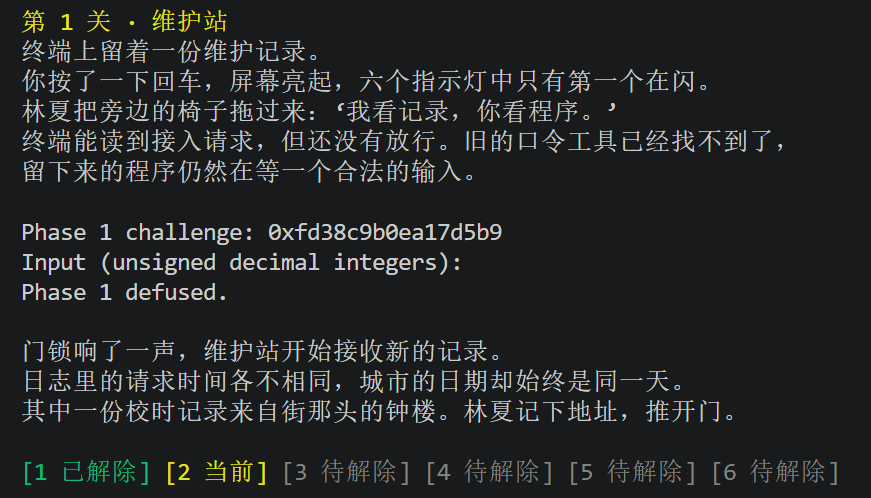
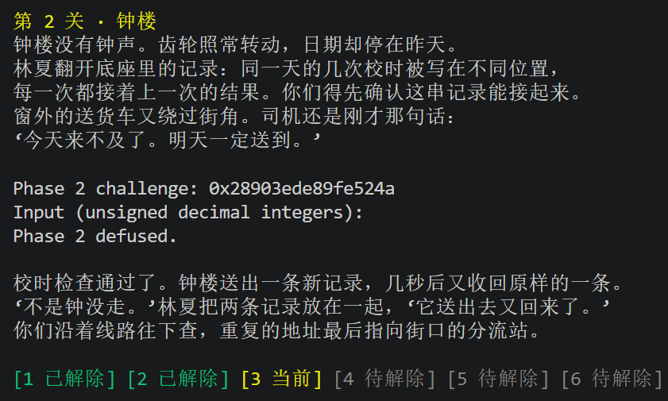
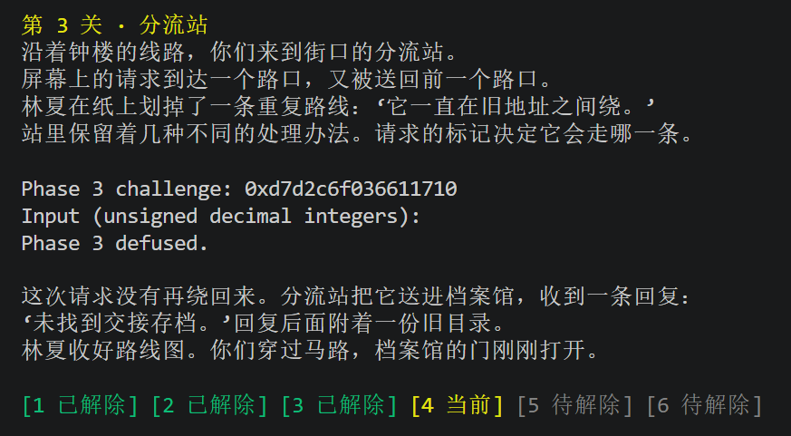
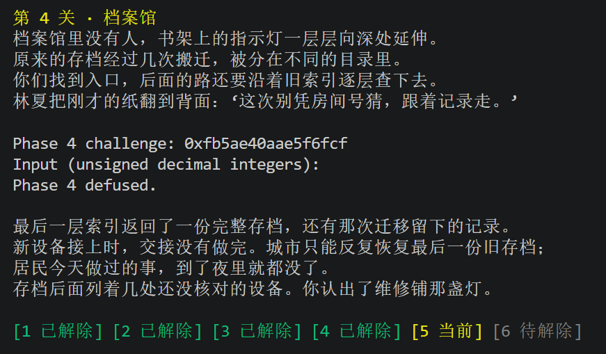
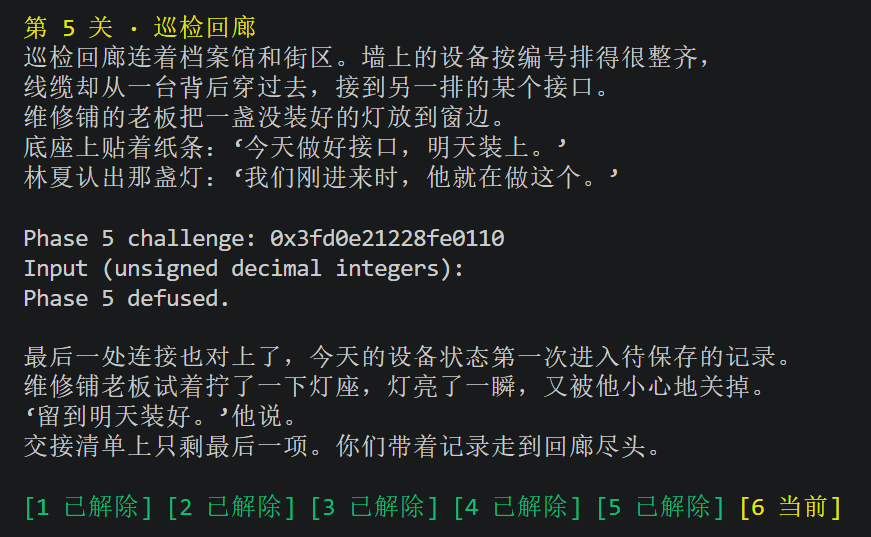
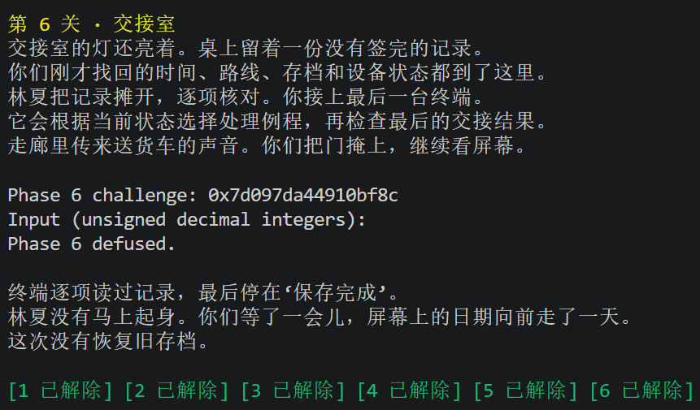
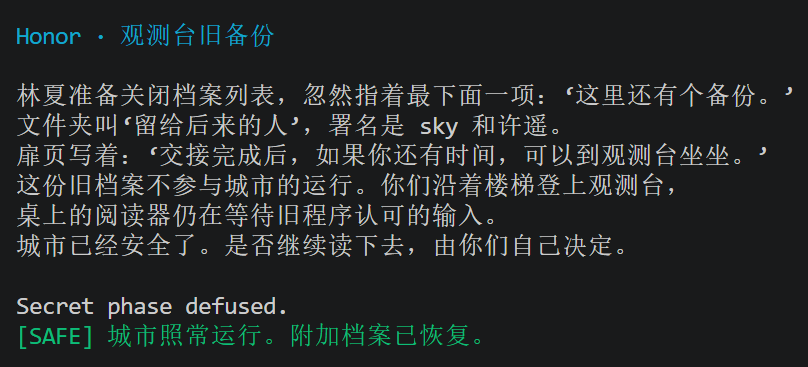
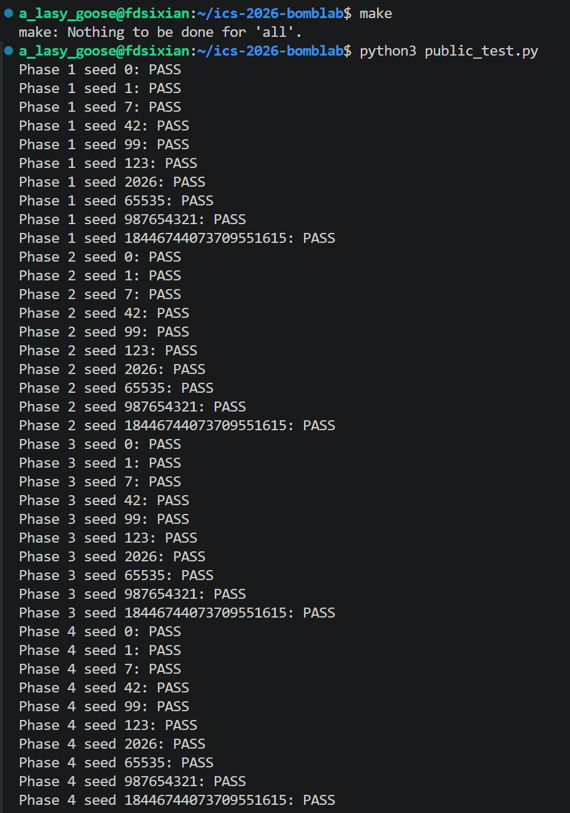
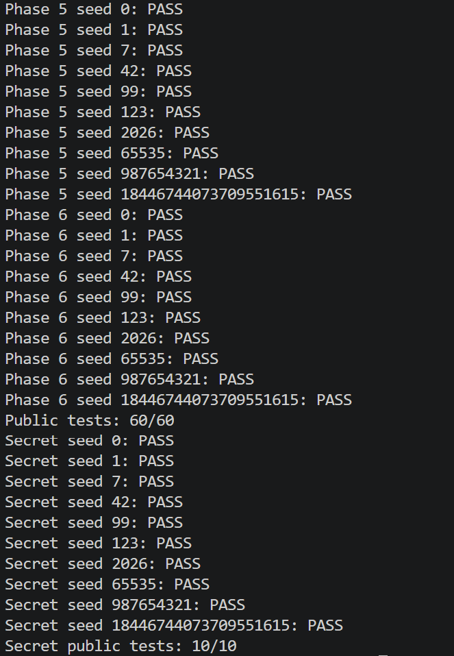

# BombLab 实验报告

## 1. 全部关卡统一设计理解

先从 `valid_u32_fields` 和 `sscanf` 确定输入字段数量，再沿 `call` 追踪核心计算函数，最后根据 `cmp` 的两个操作数确定答案顺序。

## 2. Phase 1：

### 2.1 输入推理

`phase_01` 将 `1` 作为第二个参数传给 `valid_u32_fields`，并要求 `sscanf` 返回 `1`，所以口令只有一个 `uint32_t`。随后它调用 `p1_compute(challenge)`，将返回的 `eax` 与输入整数比较。

### 2.2 计算关系

`p1_compute` 将 `challenge` 拆成三部分：

```text
low    = low32(challenge)
high   = high32(challenge)
middle = low32(challenge >> 16)
```

三个辅助函数对应：

```text
step1 = high XOR (middle + 0x7a3)
step0 = (low + 2 * high) XOR 0xfbe2
answer = 3 * (step0 - step1) + 0x49b8
```

最终将 `answer` 写入 `values[0]`，并令 `count = 1`。

### 2.3 测试

使用非公开 seed `314159`：

```bash
./defuser --seed 314159 --phase 1 | ./bomb --seed 314159 --phase 1
```

结果：

```text
Phase 1 challenge: 0xd85dda4696932a2d
Phase 1 defused.
```



## 3. Phase 2：

### 3.1 输入推理

`valid_u32_fields(input, 6)` 与 `sscanf` 的返回值检查表明，本关要求六个无符号整数。

### 3.2 第一个数推理

关键汇编为：

```asm
shr    rax,0x16
movzx  eax,al
add    eax,0xf
```

其中 `0x16` 为十进制 22，因此：

```text
values[0] = ((challenge >> 22) & 0xff) + 15
```

### 3.3 后续结果递推得到

循环使用的移位量依次为 `18, 19, 20, 21, 22`，加法常数依次为 `11, 22, 33, 44, 55`。递推关系为：

```text
extracted = (challenge >> shift) & 0x3f
values[i + 1] = (extracted XOR (2 * values[i])) + addend
```

循环执行五次，最终 `count = 6`。

### 3.4 测试

```text
Phase 2 challenge: 0x049392bee0cdfbbd
Phase 2 defused.
```



## 4. Phase 3：

### 4.1 输出推理

本关读取两个整数。第一个整数为：

```text
selector = challenge & 7
```

传给 `p3_dispatch` 的第二个参数为：

```text
mixed = low32(challenge >> 3) XOR high32(challenge)
```

第二个答案是 `p3_dispatch(selector, mixed)` 的返回值。

### 4.2 跳转表解析

`p3_dispatch` 使用：

```asm
notrack jmp QWORD PTR [rax*8+0x405820]
```

读取 `0x405820` 后得到真实映射：

| selector | 执行函数 |
|---:|---|
| 0 | `p3_case_1` |
| 1 | `p3_case_4` |
| 2 | `p3_case_5` |
| 3 | `p3_case_0` |
| 4 | `p3_case_3` |
| 5 | `p3_case_2` |
| 6 | `p3_case_7` |
| 7 | `p3_case_6` |

各函数的计算关系推理得为：

```text
p3_case_0(x) = 3x + 0x945e
p3_case_1(x) = 2x XOR 0x58d2
p3_case_2(x) = 5x + 0x1acf7
p3_case_3(x) = (x XOR 0x5591) + (x >> 1)
p3_case_4(x) = (x XOR 0x7845) + (x >> 1)
p3_case_5(x) = 5x + 0x380b3
p3_case_6(x) = 4x XOR 0xc0fc
p3_case_7(x) = 5x + 0x683f
```

最开始遇到的问题：曾直接按照 case 名称编号建立映射，导致特定 seed 失败。读取真实跳转表后重新排列分支，问题得到解决。

### 4.3 测试

```text
Phase 3 challenge: 0x1cd4d8174d7decfd
Phase 3 defused.
```



## 5. Phase 4：

### 5.1 输入推理

`phase_04` 对 `p4_walk` 的首次调用参数为：

```text
target = challenge & 0x7f
low = 0
high = 0x7f
salt = low32(challenge >> 7) XOR high32(challenge)
```

本关只输出 `p4_walk` 的返回值，因此 `count = 1`。

### 5.2 递归关系

中点计算：

```text
mid = low + ((high - low) >> 1)
```

递归关系为：

```text
若 target == mid：
    return (mid + 0x27) XOR salt

若 target < mid：
    result = p4_walk(target, low, mid - 1, salt)
    return ((3 * result) XOR (mid + salt)) XOR 0x19

若 target > mid：
    result = p4_walk(target, mid + 1, high, salt)
    return ((3 * result) XOR (mid + salt)) XOR 0x17
```

`rbx` 用于跨递归调用保存当前层的 `mid + salt`。

### 5.3 测试

```text
Phase 4 challenge: 0x6a9e8d40d5354fbc
Phase 4 defused.
```



## 6. Phase 5：

### 6.1 节点结构

由以下访问方式的汇编代码：

```asm
mov rdx,QWORD PTR [rdx]
mov esi,DWORD PTR [rdx+0x8]
add eax,DWORD PTR [rdx+0xc]
```

恢复出节点结构：

```c
struct Node {
    struct Node *next;
    uint32_t value;
    uint32_t extra;
};
```

成员偏移分别为 `0`、`8`、`12`。

### 6.2 推理过程

```text
index = challenge & 7
steps = (challenge >> 3) & 3
node = heads[index]
```

累计值初始化为：

```text
acc = low32(challenge >> 6) XOR high32(challenge) XOR 0xdfd
```

先处理头节点，再沿 `next` 移动 `steps` 次。每处理一个节点：

```text
acc = (3 * acc + node.extra) XOR node.value
out_value = node.value
```

最终 `values[0]` 为 `acc`，`values[1]` 为最后节点的 `value`。

### 6.3 内存数据恢复

通过：

```gdb
x/8gx 0x405b60
x/22gx 0x405ba0
x/2gx 0x405c50
```

恢复了链表头表以及全部相关节点。八个头节点分别从一条共享链的不同位置开始，避免了重复存储节点。

### 6.4 测试

```text
Phase 5 challenge: 0xd2b58ef282236824
Phase 5 defused.
```



## 7. Phase 6：

### 7.1 框架推理

`p6_dispatch` 连续执行两次函数指针调用：

```asm
call QWORD PTR [rax*8+0x405e00]
call QWORD PTR [rbx+0x405e00]
```

两个索引和初始参数为：

```text
first_index = challenge & 7
second_index = (challenge >> 3) & 7
argument = low32(challenge >> 6) XOR high32(challenge)
```

第一次调用后与 `0x23a0` 异或，再将结果传给第二次调用；第二次调用后加 `0x61d0`。

### 7.2 函数指针表推理

实际映射为：

| 索引 | 函数 |
|---:|---|
| 0 | `p6_op_4` |
| 1 | `p6_op_2` |
| 2 | `p6_op_3` |
| 3 | `p6_op_1` |
| 4 | `p6_op_2` |
| 5 | `p6_op_5` |
| 6 | `p6_op_0` |
| 7 | `p6_op_1` |

六种运算分别为：

```text
op0(x) = (x + 0x7823) XOR (x >> 3)
op1(x) = ((x >> 1) XOR x) + 0xb618
op2(x) = rol32(x, 1) XOR 0x7667
op3(x) = (x XOR 0xa53f) + 8x
op4(x) = ((x << 7) + 0x863d) XOR 5x
op5(x) = ror32(x, 1)
```

### 7.3 测试

```text
Phase 6 challenge: 0xc1a32713817bbecc
Phase 6 defused.
```



## 8. Honor

### 8.1 各个函数调用关系

```text
secret_gate
├── secret_copy
└── secret_phase
    └── secret_mix
```

`secret_copy` 逐字节复制到 `\0` 为止。`secret_gate` 负责外层格式，`secret_phase` 负责三个整数的验证，`secret_mix` 是一个 32 位混合函数。

### 8.2 外层格式

`secret_gate` 通过无符号长度判断要求：

```text
36 <= strlen(input) <= 163
```

它还检查偏移 32 处的四个字节等于小端常数 `0x4e45504f`，即字符串 `OPEN`。因此构造的第七行为：

```text
32 个前缀字符 + OPEN + 三个十进制无符号整数
```

### 8.3 三个整数

定义：

```text
selector = context & 3
challenge_mix = low32(challenge) XOR high32(challenge)
context_mix = low32(context) XOR high32(context)
extra_mix = selector * 0x6d92 XOR low32(context >> 16)
mix_input = challenge_mix XOR context_mix
```

`secret_mix` 为：

```text
secret_mix(x) = (7x + 0x6d92) XOR 0x4539
```

三个整数依次为：

```text
first = selector
second = secret_mix(mix_input) XOR extra_mix
third = second XOR (context_mix + selector + 0x4539 + (challenge_mix >> 1))
```

使用 `snprintf` 将完整字符串安全写入 `out`，并检查返回值以防缓冲区截断。

### 8.4 测试

非公开 seed `314159` 的完整测试结果为：

```text
Congratulations! You've defused the bomb.
Secret phase defused.
```



## 9. 综合测试结果

执行：

```bash
make
python3 public_test.py
```

真实结果：

```text
Public tests: 60/60
Secret public tests: 10/10
```




此外，使用不在公开列表中的 seed `314159` 分别验证 Phase 1 至 Phase 6，并进行包含第七行的完整管道测试，六关及 Secret 均通过。

## 10. 过程中遇到的问题与我的解决方法

1. **Phase 3 跳转表映射错误。** 最初按函数名称编号推测分支，单 seed 测试失败；读取 `0x405820` 的真实表项后修正。
2. **Phase 4 递归边界。** 右分支必须更新为 `low = mid + 1`，并在递归前保存 `mid + salt`。
3. **Phase 5 链表恢复。** 通过节点偏移和内存转储恢复 `next/value/extra`，并注意八个头指针共享同一条链的不同后缀。
4. **Phase 6 函数编号与表索引不同。** 读取 `0x405e00` 后按照真实表序建立分派。

## 12. 工具与 AI 使用说明

- GDB：查看反汇编、字符串、寄存器、跳转表、函数指针表和链表节点。
- objdump：辅助进行静态反汇编。
- GCC/Make：编译并利用 `-Wall -Wextra -Wpedantic -Werror` 检查代码。
- Codex：辅助汇总和理解项目要求，学习 x86-64 汇编指令、寄存器、栈及函数调用约定等基础知识，帮助梳理程序的控制流程和数据传递关系，协助分析解题思路、排查编译与测试过程中遇到的问题，并辅助搭建项目报告结构。

